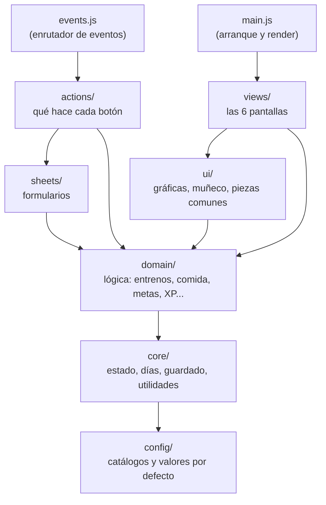
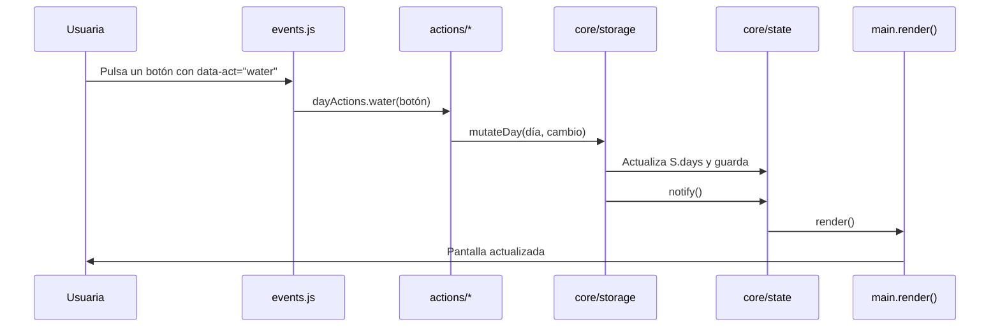

# Arquitectura de HIMNAE

HIMNAE es una aplicación web **sin frameworks ni dependencias en ejecución**: HTML, CSS y JavaScript con módulos ES nativos. El código está organizado por **capas**, y cada capa solo depende de las que tiene por debajo.

## Capas



| Capa | Carpeta | Responsabilidad | Puede tocar el DOM |
|---|---|---|---|
| Configuración | `js/config/` | Catálogos (grupos musculares, ejercicios, medidas, franjas...) y valores por defecto. Solo datos. | No |
| Núcleo | `js/core/` | Estado global, modelo de día, guardado, datos de ejemplo y utilidades. | Solo el aviso flotante |
| Dominio | `js/domain/` | Reglas de negocio: récords, volumen, rachas, XP, metas por periodo, medidas. | No |
| Interfaz | `js/ui/` | Piezas visuales reutilizables: gráficas SVG, muñeco, tarjetas comunes, iconos. Devuelven HTML como texto. | No |
| Pantallas | `js/views/` | Una función por pestaña que compone la pantalla completa. | No (devuelven HTML) |
| Formularios | `js/sheets/` | Hoja inferior y formularios de sesión, comida y suplementos. | Sí |
| Acciones | `js/actions/` | Qué pasa al pulsar cada botón o cambiar cada campo, agrupado por área. | Sí |
| Eventos | `js/events.js` | Un único listener por tipo de evento que reparte a las acciones. | Sí |
| Entrada | `js/main.js` | Carga datos, registra el render y arranca. | Sí |

## Estructura de carpetas

```
HIMNAE/
├── index.html                 Esqueleto de la página (sin lógica)
├── site.webmanifest           Nombre e iconos para instalarla en el móvil
├── assets/icons/              Icono de la app (favicon, iPhone, Android)
├── css/
│   ├── tokens.css             Colores, tipografías, tema claro/oscuro
│   ├── base.css               Reset, tipografía, botones, formularios
│   ├── components.css         Tarjetas, chips, pestañas, hoja inferior...
│   └── views.css              Estilos propios de cada pantalla
├── js/
│   ├── main.js                Arranque y render
│   ├── events.js              Clic / input / change / teclado → acciones
│   ├── config/
│   │   └── constants.js       Catálogos y ajustes por defecto
│   ├── core/
│   │   ├── state.js           Estado (S, ui) y suscripción a cambios
│   │   ├── days.js            Modelo de un día
│   │   ├── storage.js         Guardado (navegador o cuenta)
│   │   ├── demo.js            Datos de ejemplo
│   │   └── utils.js           Fechas, números, texto
│   ├── domain/
│   │   ├── training.js        Sesiones, récords, volumen
│   │   ├── nutrition.js       Comidas y totales
│   │   ├── supplements.js     Suplementación
│   │   ├── goals.js           Metas por periodo
│   │   ├── measures.js        Medidas corporales
│   │   └── stats.js           Rachas, XP y nivel
│   ├── ui/
│   │   ├── charts.js          Barra del día, líneas y barras (SVG)
│   │   ├── figure.js          Muñeco de medidas (SVG)
│   │   ├── components.js      Piezas comunes (métricas, metas, suplementos...)
│   │   ├── confirm.js         Confirmación con doble toque
│   │   └── icons.js           Iconos
│   ├── views/                 hoy · entreno · comida · cuerpo · metas · progreso
│   ├── sheets/                sheet · session · meal · supplement
│   └── actions/               navigation · day · training · nutrition ·
│                              supplements · body · goals · progress · data
├── scripts/
│   └── build-standalone.mjs   Genera dist/himnae.html (todo en un archivo)
└── docs/
    └── ARQUITECTURA.md        Este documento
```

## Flujo de datos

La app sigue un flujo **unidireccional**: la interfaz nunca se modifica a mano; se cambia el estado y se vuelve a pintar.



1. Cada botón lleva `data-act="nombre-de-la-acción"`.
2. `events.js` busca ese nombre en el mapa `ACTIONS` y llama a su función.
3. La acción cambia los datos con `mutateDay()` o `setSettings()` (o cambia `ui` y llama a `notify()`).
4. `notify()` avisa a `render()`, que vuelve a pintar la pantalla activa.

## Modelo de datos

Todo se guarda en dos bloques: **días** y **ajustes**.

```js
S.days = {
  '2026-10-14': {
    date: '2026-10-14',
    weight: 63.8,                          // kg
    water: 6,                              // vasos
    workouts: [{
      id, name: 'Torso', type: 'fuerza', min: 55, km: null, notes: '',
      exercises: [{
        group: 'pecho', name: 'Press banca', kind: 'peso',
        equip: 'Barra', grip: 'Prono', hand: 'Ambas manos', feel: 'bien',
        sets: [{ kg: 40, reps: 8 }],
        // kind: 'tiempo' → sets: [{ name, time: '45s', reps, rest: '15s' }]
      }],
    }],
    meals: [{ id, slot: 'comida', name: 'Pollo con arroz', kcal: 620, p: 45, c: 70, f: 14 }],
    supps: { idSuplemento: true },
    goals: { idMetaDiaria: true },          // o un número si la meta tiene cifra
    measures: { cintura: 70.5, cadera: 95.1, /* ... */ },
  },
};

S.settings = {
  kcal: 2000, protein: 110, water: 8, weekly: 4, mealsGoal: 4, trackKcal: true,
  supps: [{ id, name: 'Creatina', dose: '3 g', when: 'manana' }],
  goals: [{ id, text: 'Correr', period: 'month', target: 40, unit: 'km' }],
  goalDone: { 'idMeta|M2026-10': 12.5 },   // progreso de metas no diarias
};
```

## Guardado

`core/storage.js` decide dónde se guardan los datos; el resto de la app no lo sabe:

- **Navegador** (`localStorage`, clave `barra-cargada-v1`): siempre disponible. Es lo que se usa en GitHub Pages.
- **Cuenta de claude.ai**: cuando la app se abre como artifact de Claude, cada día se guarda como un documento y se sincroniza entre dispositivos.

Para pasar datos entre navegadores: **Metas → Tus datos → Copiar copia de seguridad / Restaurar**.

## Cómo añadir cosas

| Quiero... | Dónde |
|---|---|
| Un ejercicio o grupo muscular nuevo | `js/config/constants.js` → `EXERCISE_LIBRARY` / `GROUPS` |
| Una medida corporal nueva | `constants.js` → `MEASURES` y su posición en `MEASURE_POINTS` |
| Cambiar un color | `css/tokens.css` |
| Cambiar el icono | Sustituye los PNG de `assets/icons/` manteniendo los nombres y tamaños |
| Un botón nuevo | Ponle `data-act="mi-accion"` y añade `'mi-accion': (btn) => {...}` en el archivo de `js/actions/` de su área |
| Una pantalla nueva | Crea `js/views/mi-pantalla.js` y añádela a `VIEWS` en `js/main.js` (y su icono en `ui/icons.js`) |
| Un cálculo nuevo (p. ej. calorías quemadas) | Una función en el archivo de `js/domain/` que corresponda |
| Una medalla nueva | `js/views/progreso.js` → `badgesCard()` |
